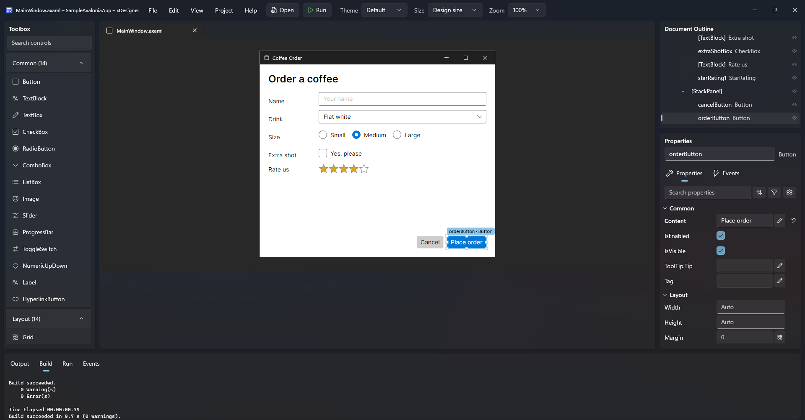

# xDesigner

**A visual designer for [Avalonia UI](https://avaloniaui.net/) 11 and 12, WinUI 3 and .NET MAUI 10 and 11, in the spirit of the classic WinForms designer.**
Drag controls onto a form, set their properties in a properties window, double-click a button to write its click
handler, and press Run. You write only C#; xDesigner writes the XAML.



> xDesigner is an independent hobby project. It is not affiliated with, or endorsed by, the Avalonia project or
> AvaloniaUI OÜ.

## Features

- **Real rendering.** Forms are drawn by their framework itself, in a separate process: Avalonia 11 or 12 (the version
  your project uses), WinUI 3, or .NET MAUI 10 or 11 (through MAUI's Windows handlers, with your own MauiProgram), with
  your app's theme, resources, fonts, images and custom controls, so what you see is what runs.
- **WinUI 3** desktop apps, unpackaged or packaged (MSIX): windows, pages and user controls; Run registers a packaged app
  as Visual Studio does (with Developer Mode on).
- **.NET MAUI** apps: content pages and content views, including MAUI 11's files without namespace declarations; built
  and run for Windows (no Android or iOS workloads needed).
- **Whole solutions.** Open a `.sln` or `.slnx` and every project is there in **Solution Explorer**, each with its own
  framework (Avalonia, WinUI and MAUI projects side by side work). Build errors are in the **Error
  List**; double-click one to go to it.
- **Toolbox** with the framework's built-in controls and the custom controls of your project.
- **Drag-and-drop layout** that understands panels: Grid cells, Canvas positions, StackPanel and WrapPanel order,
  DockPanel edges. Move, resize, snap lines, grid snapping, multi-select, rubber band, nudge with the arrow keys,
  copy and paste between files.
- **Properties window** with typed editors (colors, thickness, fonts, enums, sizes, images) and an **Events** tab.
  Double-click a control, or an event, to create its handler in the code-behind; xDesigner tells you which method it
  wrote, in which file and on which line, and opens it in your editor.
- **Document outline** with drag and drop, a right-click menu (Wrap in, Bring to front, …) and an eye icon to hide a
  control while you design.
- **Editors** for ListBox, ComboBox, TabControl, Menu and TreeView items, and for Grid rows and columns.
- **Preview** in Light or Dark theme, at common window sizes or your own, at any zoom.
- **Projects**: create a new Avalonia app, add windows and user controls, build, run and stop it from the designer.
  Images you pick are copied into the project's `Assets` folder.
- **Lossless editing**: xDesigner changes only the parts of a `.axaml` file you edit; everything else, including
  formatting and comments, stays byte for byte as it was. Undo restores the file exactly.

## Install

1. Download `xDesigner-<version>-x64-setup.exe` from the [Releases](https://github.com/CGrebill/xDesigner/releases)
   page.
2. Run it. It installs for your user account only, so no administrator rights are needed.

Windows SmartScreen may warn that the installer is from an unknown publisher, because it isn't code-signed. Choose
**More info › Run anyway** if you trust the download (the release page lists its SHA-256 checksum).

**Requirements**
- Windows 10 version 2004 or later, or Windows 11, x64. Windows on ARM runs it through emulation.
- To build and run projects: the [.NET SDK](https://dotnet.microsoft.com/download) your project uses (10 or 11), and for
  .NET MAUI projects its Windows workload (`dotnet workload install maui-windows`, in an administrator terminal).
  Opening and editing files works without them.

**Uninstall** from *Settings › Apps*. The uninstaller removes the program, its shortcuts, and everything xDesigner
stored for itself (`%LOCALAPPDATA%\xDesigner`: settings and the error log). Your projects are never touched.

## Quick start

1. **File › New project…** (Ctrl+Shift+N): pick Avalonia 12 or 11, a name and a folder. xDesigner creates the app,
   builds it and opens its main window.
2. Drag a **Button** and a **TextBlock** from the toolbox onto the window.
3. Double-click the button. xDesigner adds `button1_Click` to `MainWindow.axaml.cs` and offers to open it in your
   editor. Write, for example, `textBlock1.Text = "Hello!";`.
4. Press **Run** (F5).

The [user guide](docs/user-guide.md) covers everything else.

## Keyboard shortcuts

| Keys | Action |
|---|---|
| Ctrl+Shift+N / Ctrl+O / Ctrl+Shift+O | New project / open a file or project / open a project |
| Ctrl+S / Ctrl+Shift+S / Ctrl+W | Save / save all / close the file |
| Ctrl+Z / Ctrl+Y | Undo / redo |
| Ctrl+X / Ctrl+C / Ctrl+V / Del | Cut / copy / paste / delete the selected controls |
| Arrow keys (Shift: ×10) | Nudge the selection, or reorder it in a StackPanel |
| Esc / Tab / Ctrl+A | Select the parent / the next sibling / all siblings |
| Alt while dragging | Keep the control in its container and don't snap |
| Ctrl+mouse wheel, Ctrl+= / Ctrl+- / Ctrl+0 / Ctrl+9 | Zoom / in / out / 100% / fit |
| F4 | Go to the Properties window |
| F5 / Shift+F5 / Ctrl+Shift+B | Run / stop / rebuild the project |
| Ctrl+, | Settings |

## What xDesigner doesn't do

xDesigner is for designing forms visually. It doesn't author data bindings, styles, resources, control templates or
animations; bindings and resources already in a file are kept and shown read-only (WinUI's compiled `{x:Bind}`
bindings render without their values). It designs Avalonia 11 (11.1 or later) and 12 desktop apps (Windows, macOS and
Linux run them), WinUI 3 apps on the Windows App SDK, and .NET MAUI 10 and 11 apps as they look on Windows (Shell
navigation isn't designed visually). The designer itself runs on Windows only.

## Build from source

You need Windows, the .NET 11 SDK (`global.json` picks it; it builds the .NET 10 projects too) and its MAUI workload
(`dotnet workload install maui-windows`, from an administrator terminal), which the MAUI renderers and sample need.

```powershell
dotnet build xDesigner.slnx
dotnet test xDesigner.slnx
dotnet run --project src/XDesigner.App
```

The release installer is built by `build\publish.ps1`, which also needs [Inno Setup 6](https://jrsoftware.org/isinfo.php).
See [CONTRIBUTING.md](CONTRIBUTING.md) for the project layout and conventions, and
[docs/ARCHITECTURE.md](docs/ARCHITECTURE.md) for how it works.

## License

xDesigner is **source-available** under the [PolyForm Noncommercial License 1.0.0](LICENSE.md): you may use, copy,
modify and share it for any noncommercial purpose (personal projects, study, hobby work, research, and use by
charities, schools and public bodies). Commercial use needs the author's permission.

The files xDesigner generates in your projects (new project templates, event handler stubs, the XAML it writes) are
yours, and you may use them under any terms you like, commercial or not.

xDesigner includes third-party components under their own licenses; see
[THIRD-PARTY-NOTICES.md](THIRD-PARTY-NOTICES.md).
